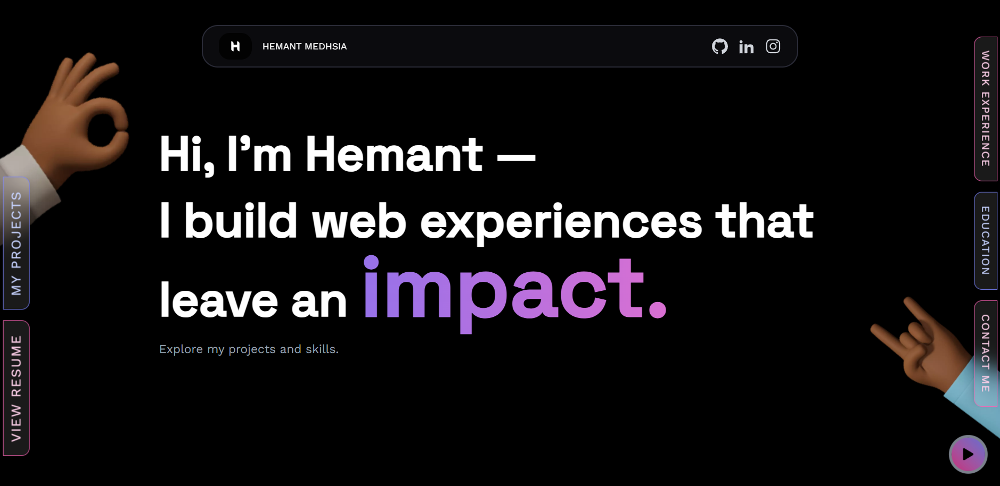

# 🚀 Hemant Medhsia's Developer Portfolio

Welcome to my **personal developer portfolio** built using **React**, **TypeScript**, **Vite**, and **Tailwind CSS**. This website is a dynamic and interactive showcase of my skills, projects, education, and experience—all wrapped in a modern, visually engaging design.




---

## 🔥 Features

- ⚡ Fast and optimized using [Vite](https://vitejs.dev/)
- 🌈 Smooth scrolling with Locomotive Scroll
- ✨ Interactive UI with Framer Motion
- 🧠 Type-safe development using TypeScript
- 🎨 Responsive & modern design with Tailwind CSS
- 💌 Contact form with form validation
- 💼 Projects, education, experience, and testimonial sections
- 🎵 Optional background music with toggle
- 🔁 Tech stack logos & marquee animations

---

## 🛠️ Tech Stack

| Category       | Technologies                                                                 |
| -------------- | ---------------------------------------------------------------------------- |
| **Frontend**   | React, TypeScript, Vite, Tailwind CSS, Framer Motion                         |
| **Routing**    | React Router DOM                                                             |
| **Animation**  | Framer Motion, Locomotive Scroll                                             |
| **Deployment** | [Vercel](https://vercel.com)                                                 |
| **Utilities**  | ESLint, Prettier, custom hooks, context API for global state                 |

---

## 📁 Project Structure Overview

<pre>
  📁 Portfolio/
├── 📄 .gitignore
├── 📄 README.md
├── 📄 index.html
├── 📦 public/
│   ├── 📄 HemantMedhsiaUpdatedResume.pdf
│   ├── 🖼️ gProfile1.png
│   └── 🖼️ og-image.png
├── 📦 src/
│   ├── 📄 App.tsx
│   ├── 📄 App.css
│   ├── 📁 apis/
│   │   └── 📁 Contactme/
│   │       └── 📄 Contactme.ts
│   ├── 📁 assets/
│   │   └── 📁 Images/
│   │       ├── 🏢 Company/
│   │       ├── 🎓 Education/
│   │       ├── 🧰 HelperImgs/
│   │       ├── 🔢 Numbers/
│   │       ├── 💼 Projects/
│   │       └── 🧱 stack/
│   ├── 📁 components/
│   │   ├── 👤 About/
│   │   ├── 📞 Contactme/
│   │   ├── 🎓 Education/
│   │   ├── 💼 Experience/
│   │   ├── 🌟 Github/
│   │   ├── 🎵 Music/
│   │   ├── 🧪 LazyImage/
│   │   ├── 🌀 Marquee/
│   │   ├── 🔁 ScrollToTop/
│   │   ├── ✨ Testimonials/
│   │   └── ...more UI sections
│   ├── 📁 context/
│   │   └── 🎵 MusicContext.tsx
│   ├── 📁 Data/
│   │   └── 📄 projectsData.ts
│   ├── 📁 Layout/
│   │   ├── 📄 Header.tsx
│   │   └── 📄 Footer.tsx
│   ├── 📁 pages/
│   │   ├── 🏠 Home.tsx
│   │   ├── 📄 About.tsx
│   │   ├── 🧠 Education.tsx
│   │   ├── 💼 Experience.tsx
│   │   ├── 📨 Contactme.tsx
│   │   ├── 🧾 Resume.tsx
│   │   └── ❌ Error404.tsx
│   ├── 📁 Routes/
│   │   └── 📄 RoutesConfig.tsx
│   ├── 📁 Ui/
│   │   ├── 📁 GradientLine/
│   │   └── 📁 InputFields/
│   ├── 📄 main.tsx
│   ├── 📄 index.css
│   ├── 📁 types/
│   │   └── 📄 hover-effect.d.ts
│   └── 📄 vite-env.d.ts
├── 📄 package.json
├── 📄 package-lock.json
├── 📄 tsconfig.json
├── 📄 tsconfig.app.json
├── 📄 tsconfig.node.json
├── 📄 vite.config.ts
├── 📄 eslint.config.js
├── 📄 vercel.json
</pre>


## High-Level Summary

The repository appears to be a personal portfolio website built using React, TypeScript, and Vite. The website showcases the developer's skills, experience, and projects. It features a modern design with animations, marquee effects, and a smooth scrolling experience.

## Low-Level Summary

The repository contains a React application built with Vite, a modern front-end build tool. The application is written in TypeScript and uses various libraries and frameworks, including:

* React Router for client-side routing
* Framer Motion for animations
* Locomotive Scroll for smooth scrolling
* Tailwind CSS for styling

The application consists of various components, including:

* Header and footer components
* Project cards with images, descriptions, and links
* Education and experience sections
* A testimonials section
* A contact form

The repository also includes configuration files for ESLint, TypeScript, and Vercel.

## Installing and Running Process

To install and run the application, follow these steps:

### Prerequisites

* [Node.js](https://nodejs.org/) (v16 or higher recommended)
* npm or yarn

### Installation

. Clone the repository using Git: `git clone https://github.com/HemantMedhsia/Portfolio2025.git`
. Navigate to the repository directory: `cd Portfolio`
. Install the dependencies using npm or yarn: `npm install` or `yarn install`

### Running the Application

. Start the development server: `npm run dev` or `yarn dev`
. Open a web browser and navigate to `http://localhost:`

The application should now be running and accessible in your web browser.

## Code Block for Installation and Running

`````bash
# 1️⃣ Clone the repository
git clone https://github.com/HemantMedhsia/Portfolio2025.git

# 2️⃣ Navigate to the directory
cd Portfolio

# 3️⃣ Install the dependencies
npm install    # or yarn install

# 4️⃣ Run the app
npm run dev    # or yarn dev

# 🔗 Open in browser
# http://localhost:5173

`````

## 📩 Contact & Support

If you have any questions, feedback, or need support, feel free to reach out:

- 📧 Email: [hemantmedhsia@gmail.com](mailto:hemantmedhsia@gmail.com)
- 🐞 Bug Reports: [Create an issue](https://github.com/HemantMedhsia/Portfolio2025/issues)
- ⭐ Suggestions & Features: [Start a discussion](https://github.com/HemantMedhsia/Portfolio2025/discussions)
- 🤝 Want to Contribute? [Fork the repo](https://github.com/HemantMedhsia/Portfolio2025/fork) and submit a PR!

---

> Your support matters! If you liked this project, don’t forget to ⭐ star the repository and share it with others.


